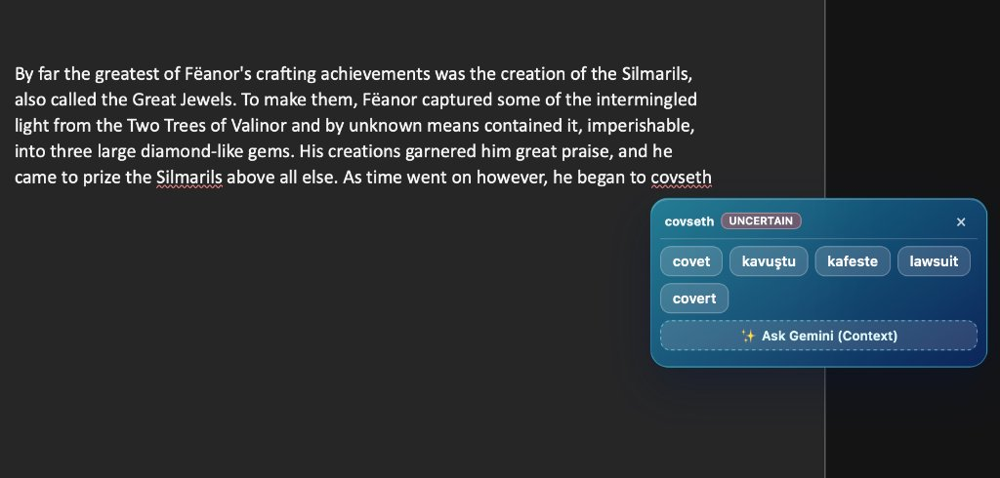
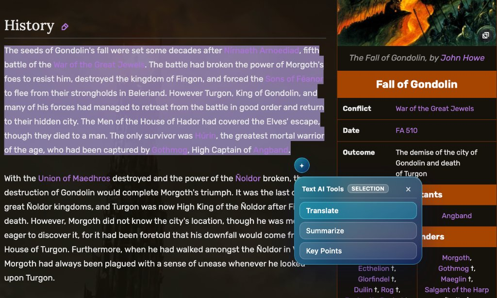
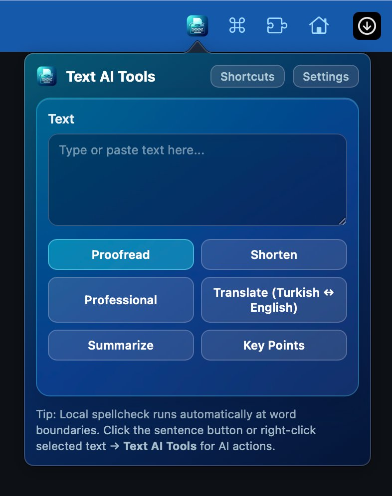
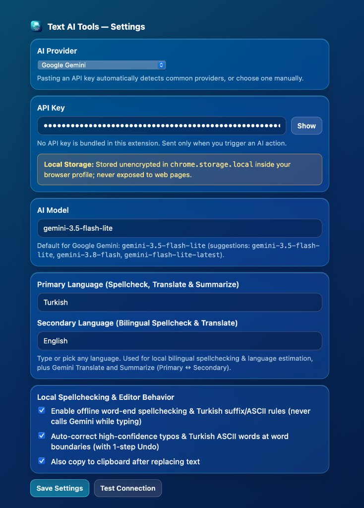
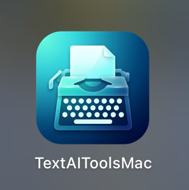
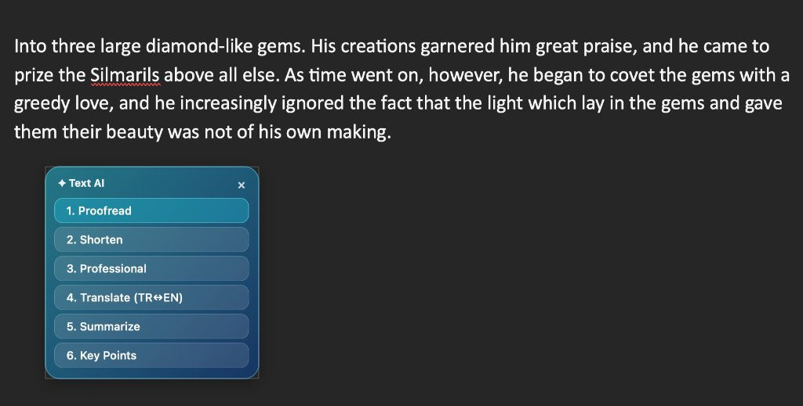

# Text AI Tools

Offline word-end spellchecking (Turkish & English) + optional, manually triggered AI text tools (**Proofread**, **Shorten**, **Professional**, **Translate**, **Summarize**, **Key Points**).

Works with **any AI provider / model** (bring your own API key or local model) in two ways:
1. **Browser Extension** (Chromium & Orion)
2. **macOS System-Wide App** (all Mac apps via menu bar)

---

## 1. Browser Extension

1. Clone or download this repository.
2. Open your browser's extensions page (`chrome://extensions` or **Settings → Extensions**) and enable **Developer mode**.
3. Click **Load unpacked** and select this repository folder.
4. Click the extension icon → **Settings**:
   - Paste your **API Key** (auto-detects provider) or pick one manually (**Google Gemini**, **OpenAI**, **Anthropic**, **OpenRouter** with `:free` models, **Groq**, or **Custom / Local** e.g. Ollama).
   - Pick or type any **AI Model** and set your **Primary / Secondary Languages**.

### Usage
- **Auto-Correct:** Just type normally in any text box; spellcheck runs locally on your machine at word boundaries (no API calls).
- **AI Actions:** Select text or place the cursor at the end of a sentence and click **`✦`**, right-click → **Text AI Tools**, or use the extension popup.
- **Updates:** Automatically reloads when disk files update (e.g. synced by the Mac app) and shows an **Update** banner in the popup when a newer version is available on GitHub.

<p align="center">
  <em>Offline spellchecker flags uncertain words with a wavy underline and shows local candidates (plus optional AI context lookup):</em><br/>
  
</p>

<p align="center">
  <em>Select text on any webpage and click <code>✦</code> to translate, summarize, or extract key points inline:</em><br/>
  
</p>

<p align="center">
  <em>Quick-access popup for running AI actions on pasted text or checking extension shortcuts:</em><br/>
  
</p>

<p align="center">
  <em>Configure your AI provider, model, primary/secondary languages, and local spellcheck behavior:</em><br/>
  
</p>

---

## 2. macOS System-Wide App

<p align="center">
  
</p>

### Build & Launch
```bash
bash macos/build.sh
open ~/Applications/TextAIToolsMac.app
```
*(Requires macOS, Node.js, and Xcode Command Line Tools.)*

### First-Time Permissions
On first launch, go to **System Settings → Privacy & Security** and enable **Text AI Tools** under:
1. **Accessibility**
2. **Input Monitoring**

*(The build script signs the app with a persistent local certificate in your Keychain so permissions stay intact across updates.)*

### Usage & Customization
- **System-Wide Auto-Correct:** Works across Mac apps (Notes, WhatsApp, Slack, Mail, etc.) and skips browsers/terminals/password fields by default. Press `Cmd+Z` or `Backspace` to undo.
- **Global Shortcut (`Right ⌘ + .`):** Select text anywhere on your Mac and press **Right Command + `.`** to open the floating menu (`1`–`6` keys or click).
- **Change Shortcut:** Click the typewriter icon in the menu bar → **Shortcut: … (Change…)**.
- **Set API Key:** Menu bar → **Set API Key…** (stored securely in your **macOS Keychain**).
- **Background Auto-Update:** Checks local file changes every 5 minutes and `origin/main` hourly, reloading the engine or rebuilding smoothly in the background (toggleable in the menu bar).

<p align="center">
  <em>Press <code>Right ⌘ + .</code> in any macOS app to open the floating liquid-glass AI menu:</em><br/>
  
</p>

---

## Security & Tests

- **Zero automatic AI calls:** Typing is never sent to any external server; AI is only called when you trigger an action.
- **Key storage:** Browser extension stores your key locally in `chrome.storage.local`; the macOS app stores it in **macOS Keychain**.
- **Run tests:**
  ```bash
  node --test tests/unit/*.test.mjs
  ```
